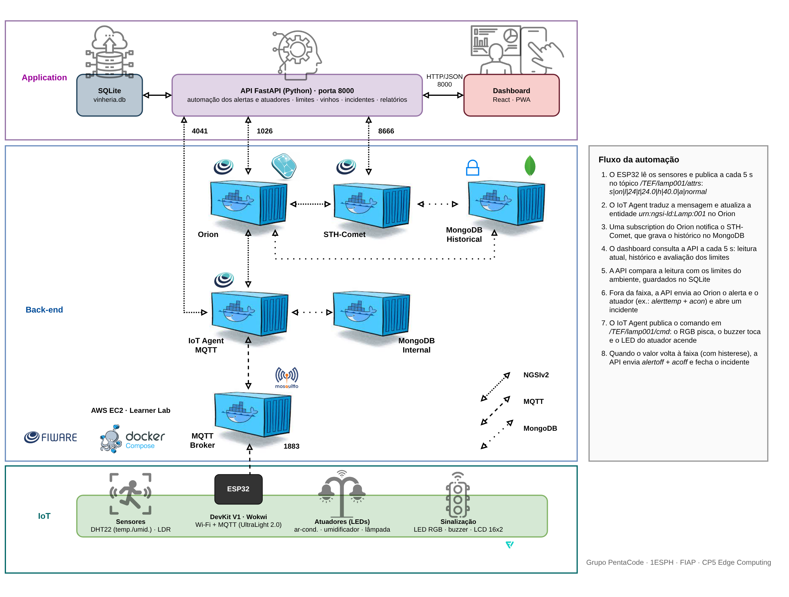

# Monitoramento de Vinherias — CP5 Edge Computing

Sistema de monitoramento de adegas com ESP32 e FIWARE. O equipamento mede temperatura, umidade e luminosidade, publica as leituras via MQTT e recebe comandos de volta. O dashboard web mostra os dados ao vivo e o histórico, permite cadastrar os dispositivos, ajustar os limites (triggers) de cada grandeza e aciona os alertas e atuadores quando um valor sai da faixa.

**Simulação no Wokwi:** <https://wokwi.com/projects/479223829887836161>

## Integrantes — Grupo PentaCode (1ESPH)

| Nome | RM |
|---|---|
| Andre Luiz | 573575 |
| Arthur Jircik Cronemberger | 570754 |
| Felipe Garcia | 571741 |
| Guilherme Amorim | 569024 |
| Matheus Marcelino Morais | 571472 |

## A solução

O vinho é sensível ao ambiente: calor acelera o envelhecimento, ar seco resseca a rolha e luz degrada os aromas. A solução vigia essas três grandezas e reage sozinha quando alguma sai da faixa ideal.

- **Sensores:** DHT (temperatura e umidade) e LDR (luminosidade), lidos a cada 5 s.
- **Alerta visual e sonoro:** o LED azul da placa pisca enquanto houver qualquer anomalia, e o buzzer toca com um som diferente para cada tipo (agudo para temperatura, médio para umidade, grave para luminosidade). Como diferencial, um LED RGB funciona de semáforo (verde normal, vermelho temperatura, amarelo umidade/luminosidade) e um display LCD 16x2 mostra as leituras e o alerta no próprio equipamento.
- **Atuadores:** LEDs representam o ar condicionado, o umidificador e a lâmpada do ambiente (com intensidade por PWM).
- **Alertas acionados pelo front-end:** o ESP32 não decide nada. O dashboard pede para a API comparar a leitura com os limites, e a API envia os comandos ao FIWARE, que os entrega ao ESP32 por MQTT.
- **Dashboard:** leituras ao vivo, gráficos dinâmicos com o histórico do STH-Comet (porta 8666), cadastro dos IoT Devices, ajuste dos triggers, estoque de vinhos, registro de incidentes, relatórios e um modo de simulação para demonstrar os alertas.

## Arquitetura



A arquitetura segue as três camadas do FIWARE Descomplicado usado em aula. O arquivo editável está em [`docs/arquitetura.drawio`](docs/arquitetura.drawio) (abre no draw.io).

- **IoT:** ESP32 com sensores, atuadores e sinalização. Publica em `/TEF/lamp001/attrs` e escuta `/TEF/lamp001/cmd` no formato UltraLight 2.0.
- **Back-end (EC2):** Mosquitto, IoT Agent MQTT (4041), Orion Context Broker (1026), STH-Comet (8666) e MongoDB, todos em Docker.
- **Aplicação:** API em FastAPI (8000) com SQLite, e o dashboard em React servido pela própria API.

### Fluxo de um alerta

1. O ESP32 publica `s|on|l|24|t|24.0|h|40.0|a|normal` a cada 5 s.
2. O IoT Agent atualiza a entidade `urn:ngsi-ld:Lamp:001` no Orion, e uma subscription grava o histórico no STH-Comet.
3. O dashboard chama `POST /api/triggers/avaliar` a cada 5 s. A API compara a leitura com os limites salvos no SQLite.
4. Fora da faixa, a API envia o comando de alerta (`alerttemp`, `alerthum` ou `alertlum`) e liga o atuador que corrige o problema (`acon` para calor, `umidon` para ar seco, `luz0` para excesso de luz). Um incidente é aberto.
5. O ESP32 pisca o LED azul e o RGB e toca o buzzer até o valor voltar à faixa.
6. Quando o valor normaliza (com uma pequena histerese para não oscilar no limite), a API envia `alertoff`, desliga o atuador e fecha o incidente.

> A avaliação é feita pelo dashboard: os alertas automáticos funcionam enquanto ele estiver aberto em algum navegador.

## Manual do hardware

### Componentes

| Componente | Quantidade | Função |
|---|---|---|
| ESP32 DevKit V1 | 1 | Controlador, Wi-Fi e MQTT (LED azul onboard no GPIO 2) |
| DHT11 (laboratório) ou DHT22 (Wokwi) | 1 | Temperatura e umidade |
| Módulo LDR | 1 | Luminosidade |
| Buzzer | 1 | Alerta sonoro |
| LED RGB catodo comum | 1 | Semáforo do ambiente |
| LEDs (ciano, branco, azul) | 3 | Ar condicionado, lâmpada e umidificador |
| Resistores 220 Ω | 6 | Um por cor do RGB e um por LED |
| Display LCD 16x2 I2C | 1 | Leituras e alerta no equipamento |
| Protoboard e jumpers | — | Montagem |

### Ligações

| Componente | Pino do ESP32 |
|---|---|
| DHT (dados) | GPIO 15 |
| LDR (saída analógica) | GPIO 34 |
| Buzzer | GPIO 4 |
| LED RGB — vermelho / verde / azul | GPIO 25 / 26 / 27 |
| LED do ar condicionado | GPIO 18 |
| LED do umidificador | GPIO 19 |
| LED da lâmpada (PWM) | GPIO 23 |
| LCD I2C — SDA / SCL | GPIO 21 / 22 |
| LED azul de alerta | GPIO 2 (já vem na placa) |

Todos os LEDs passam por um resistor de 220 Ω até o GND. O circuito completo está em [`firmware/diagram.json`](firmware/diagram.json) e pode ser visto no link do Wokwi.

### Firmware

O código está em [`firmware/sketch.ino`](firmware/sketch.ino), com as bibliotecas em [`firmware/libraries.txt`](firmware/libraries.txt): PubSubClient, DHT sensor library, Adafruit Unified Sensor e LiquidCrystal I2C.

Antes de gravar, ajuste no início do arquivo:

- `default_BROKER_MQTT`: IP público da EC2. **Muda a cada sessão do Learner Lab.**
- `default_SSID` e `default_PASSWORD`: rede Wi-Fi do laboratório (no Wokwi é `Wokwi-GUEST`, sem senha).
- `#define TIPO_DHT`: `DHT22` no Wokwi, `DHT11` no laboratório.

Grave pela Arduino IDE com a placa "ESP32 Dev Module". No Monitor Serial (115200) aparece a conexão com o broker e cada mensagem publicada.

### Comandos aceitos pelo ESP32

| Comando | Efeito |
|---|---|
| `on` / `off` | Liga ou desliga a lâmpada |
| `luz0` … `luz3` | Intensidade da lâmpada (apagada, baixa, média, alta) |
| `acon` / `acoff` | Ar condicionado |
| `umidon` / `umidoff` | Umidificador |
| `alerttemp` / `alerthum` / `alertlum` | Ativa o alerta da anomalia (LED azul + RGB + buzzer) |
| `alertoff` | Encerra o alerta |

## Manual do software

### 1. FIWARE na EC2

Na instância EC2 (Ubuntu), suba o FIWARE Descomplicado:

```bash
sudo apt install docker.io docker-compose
git clone https://github.com/fabiocabrini/fiware
cd fiware
sudo docker-compose up -d
```

Libere no Security Group as portas **1026, 1883, 4041, 8666** e **8000** (a da API).

Crie o service group do IoT Agent uma única vez (os headers `fiware-service: smart` e `fiware-servicepath: /` são obrigatórios):

```bash
curl -X POST http://IP_EC2:4041/iot/services \
  -H 'Content-Type: application/json' -H 'fiware-service: smart' -H 'fiware-servicepath: /' \
  -d '{"services":[{"apikey":"TEF","cbroker":"http://orion:1026","entity_type":"Thing","resource":""}]}'
```

Use o hostname interno `orion` no `cbroker`, e não o IP público: assim o FIWARE continua funcionando quando o IP da EC2 mudar.

O dispositivo em si (`lamp001`) é provisionado pelo dashboard, no passo 4.

### 2. API (FastAPI)

Requer Python 3.10 ou mais novo.

```bash
cd backend-python
python -m venv .venv
source .venv/bin/activate        # no Windows: .venv\Scripts\activate
pip install -r requirements.txt
cp .env.example .env             # coloque o IP da EC2 em FIWARE_HOST
uvicorn app.main:app --reload --port 8000
```

Teste: `curl http://localhost:8000/api/health`. A documentação interativa fica em `http://localhost:8000/docs`.

### 3. Dashboard (React)

Requer Node 18 ou mais novo.

```bash
cd frontend
npm install
npm run dev                       # http://localhost:5173
```

O Vite redireciona `/api` para `http://localhost:8000`. Se a API estiver em outra porta: `API_URL=http://localhost:8010 npm run dev`.

Para publicar tudo na EC2, rode `npm run build`: a API serve a pasta `frontend/dist` e o sistema inteiro fica em `http://IP_EC2:8000`.

```bash
uvicorn app.main:app --host 0.0.0.0 --port 8000
```

### 4. Primeiro uso

1. Abra o dashboard, vá em **Ambientes** e cadastre o ambiente com o nome e o local da adega, id do dispositivo `lamp001` e entidade `urn:ngsi-ld:Lamp:001`. A API provisiona o device no IoT Agent com todos os comandos e cria a subscription do STH-Comet.
2. Ligue o ESP32 (ou inicie a simulação no Wokwi). Em até 5 s as leituras aparecem no Painel.

## Manual de operação

| Tela | O que faz |
|---|---|
| **Painel** | Leituras ao vivo com a faixa aceita de cada grandeza, índice de conservação, controles da lâmpada, ar e umidificador, teste manual de cada alerta e gráfico do histórico (STH-Comet). Atualiza a cada 5 s. |
| **Limites** | Ajuste dos triggers de temperatura, umidade e luminosidade. Padrão: 12–18 °C, 60–80 % e 0–30. |
| **Vinhos** | Estoque da adega e índice de saúde de cada rótulo, calculado pelos incidentes do ambiente. |
| **Eventos** | Registro das anomalias: quando começaram, quando terminaram e o valor que as disparou. |
| **Relatórios** | Resumo do período, exportação em CSV e log dos comandos enviados. |
| **Simulação** | Provoca uma anomalia real estreitando o limite (calor, frio, seco, úmido, luz) para demonstrar alerta e atuador. "Restaurar" devolve os limites originais. |
| **Ambientes** | Cadastro, listagem e remoção dos IoT Devices no FIWARE. |

## Rotas da API

| Método | Rota | Descrição |
|---|---|---|
| GET | `/api/health` | Verifica se a API está no ar |
| GET | `/api/status` | Leitura atual: estado, luminosidade, temperatura, umidade e alerta |
| GET | `/api/history/{grandeza}?last_n=30` | Histórico do STH-Comet (`temperature`, `humidity`, `luminosity`) |
| POST | `/api/lamp/{on\|off}` | Liga ou desliga a lâmpada |
| POST | `/api/alerts/{comando}` | Aciona um alerta manualmente (`alerttemp`, `alerthum`, `alertlum`, `alertoff`) |
| POST | `/api/atuadores/{comando}` | Ar, umidificador e intensidade da luz |
| GET | `/api/comandos` | Log dos comandos enviados |
| GET / PUT | `/api/triggers` | Lê ou salva os limites |
| POST | `/api/triggers/avaliar` | Compara a leitura com os limites e aciona alerta e atuador |
| GET | `/api/triggers/eventos` | Incidentes registrados |
| GET / POST / DELETE | `/api/devices` | Lista, cadastra (provisiona no FIWARE) e remove dispositivos |
| GET / POST / PUT / DELETE | `/api/vinhos` | Estoque de vinhos |
| GET | `/api/relatorios`, `/api/relatorios/csv`, `/api/relatorios/saude` | Relatórios e índice de saúde |
| GET / POST | `/api/simulacao/cenarios`, `/api/simulacao/{cenario}` | Modo de demonstração |

## Estrutura

```
├── backend-python/        # API FastAPI
│   ├── app/
│   │   ├── main.py        # Aplicação, CORS e entrega do build do React
│   │   ├── config.py      # Variáveis de ambiente e URLs do FIWARE
│   │   ├── database.py    # Conexão SQLite (SQLAlchemy)
│   │   ├── schema.py      # Tabelas: dispositivos, triggers, vinhos, eventos, comandos
│   │   ├── models.py      # Modelos de entrada e saída (Pydantic)
│   │   ├── routers/       # Camada de apresentação (rotas HTTP)
│   │   └── services/      # Camada de negócio (fiware.py é o único que fala com o FIWARE)
│   ├── requirements.txt
│   └── .env.example
├── frontend/              # Dashboard React (Vite, PWA)
├── firmware/              # sketch.ino, diagram.json e libraries.txt do ESP32
└── docs/                  # Diagrama de arquitetura
```
